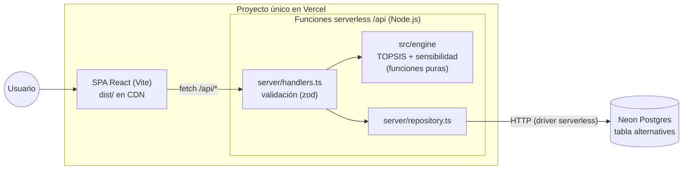

# Análisis de requerimientos, diseño y arquitectura

## 1. Trazabilidad de requerimientos (entrega 1 → implementación)

| # | Requerimiento (entrega 1) | Implementación |
| --- | --- | --- |
| §1 | Aplicación web de soporte a decisiones basada en TOPSIS | SPA en React + API serverless en Node.js, ambas en un solo proyecto de Vercel |
| §2 | Distancia a la solución ideal positiva y a la negativa; ranking fundamentado | Motor [`src/engine/topsis.ts`](../src/engine/topsis.ts); la interfaz muestra los 5 pasos con sus fórmulas |
| §3 | Base de datos inicial con las principales IAs | Tabla `alternatives` en Postgres (Neon) con 8 modelos semilla y ABM desde la interfaz |
| §4 | Criterios C1–C6 con su sentido (C1 minimizar, C2–C6 maximizar) | [`src/domain/criteria.ts`](../src/domain/criteria.ts); rúbricas Likert para C5 y C6 ([DATOS.md](DATOS.md)) |
| §5 | Perfiles predefinidos (Programación C2 = 35 %, Económico C1 = 40 %) | 6 perfiles en [`src/domain/profiles.ts`](../src/domain/profiles.ts) |
| §5 | Asignación libre de pesos con suma = 1 y análisis de sensibilidad | Sliders y campos numéricos con validación de suma y botón "Normalizar"; página **Sensibilidad** |
| §6 | Backend transaccional que aloja la matriz y ejecuta TOPSIS en tiempo real | `POST /api/topsis` lee la matriz de Postgres y ejecuta el motor; se recalcula automáticamente al cambiar pesos o selección; el reset de datos corre en una transacción |
| §6.1–6.5 | Normalización, ponderación, SIP/SIN, distancias, proximidad relativa | Una función por paso, todas expuestas en la respuesta |
| §7 | Eliminar el sesgo subjetivo | Pesos explícitos, datos con fuente citada y desarrollo completo visible |

## 2. Decisiones del dominio (acordadas con el grupo)

| Tema | Decisión | Motivo |
| --- | --- | --- |
| Normalización | Vectorial (Hwang y Yoon) | Es la del TOPSIS clásico usado por la cátedra |
| C1 costo | Mezcla 3:1 de entrada/salida | Estándar de Artificial Analysis; refleja el uso típico |
| C2 calidad | Índice compuesto (AA Intelligence Index) | Un único benchmark está saturado o contaminado |
| C5 / C6 | Likert 1–5 con rúbrica documentada | Los criterios cualitativos necesitan escala y criterio explícitos |
| C5 rúbrica | Por modalidades de entrada/salida | Es objetiva y verificable en la fuente |
| C6 pesos abiertos | Puntaje 5 (autoalojable) | Los datos no salen de la infraestructura propia |
| Alternativas | 8 modelos actuales, uno por proveedor | Los modelos de 2024 de la entrega 1 ya están discontinuados |
| Persistencia | Postgres (Neon) con ABM | Cumple con el "backend transaccional" |
| Pasos intermedios | Se muestran todos | Permite defender el método ante la cátedra |

## 3. Arquitectura



- **Un solo despliegue.** Vercel sirve el frontend compilado (`dist/`) y convierte cada archivo de `api/` en una función serverless. `vercel.json` redirige las rutas de la SPA a `index.html`, salvo `/api/*`.
- **Motor aislado.** `src/engine` no importa nada externo: lo usan el backend y los tests, y se podría usar en el navegador sin cambios.
- **Capa HTTP independiente del proveedor.** Los handlers (`server/handlers.ts`) reciben y devuelven objetos planos. `toVercel()` los adapta a Vercel y `scripts/dev-api.ts` los monta localmente, así que los tests llaman a los handlers directamente.
- **Repositorio con dos implementaciones.** `PostgresRepository` (Neon por HTTP, adecuado para serverless porque no mantiene conexiones abiertas) y `MemoryRepository` (se usa cuando no hay `DATABASE_URL`; sirve para desarrollo local). El SQL se prueba contra Postgres real con PGlite.
- **Esquema autoinicializado.** En el primer acceso, cada instancia ejecuta `CREATE TABLE IF NOT EXISTS` y, si la tabla está vacía, carga la semilla con `ON CONFLICT DO NOTHING`, de forma idempotente. No hace falta correr migraciones al desplegar.

## 4. Modelo de datos

```sql
CREATE TABLE alternatives (
  id                 SERIAL PRIMARY KEY,
  name               TEXT NOT NULL,
  provider           TEXT NOT NULL,
  variant            TEXT NOT NULL DEFAULT '',
  open_weights       BOOLEAN NOT NULL DEFAULT FALSE,
  price_input        DOUBLE PRECISION NOT NULL CHECK (price_input >= 0),        -- USD / 1M
  price_output       DOUBLE PRECISION NOT NULL CHECK (price_output >= 0),       -- USD / 1M
  intelligence_index DOUBLE PRECISION NOT NULL CHECK (intelligence_index BETWEEN 0 AND 100), -- C2
  context_window     INTEGER NOT NULL CHECK (context_window > 0),               -- C3
  output_speed       DOUBLE PRECISION NOT NULL CHECK (output_speed >= 0),       -- C4
  multimodal_score   SMALLINT NOT NULL CHECK (multimodal_score BETWEEN 1 AND 5),-- C5
  privacy_score      SMALLINT NOT NULL CHECK (privacy_score BETWEEN 1 AND 5),   -- C6
  notes              TEXT NOT NULL DEFAULT '',   -- justificación de C5/C6
  source_url         TEXT NOT NULL DEFAULT '',
  updated_at         TIMESTAMPTZ NOT NULL DEFAULT NOW(),
  UNIQUE (name, variant)
);
```

Se guardan los **precios de entrada y salida por separado** y C1 se deriva al construir la matriz ($(3 p_{in} + p_{out})/4$). Así, si cambia la proporción, alcanza con modificar una constante (`BLEND_INPUT_RATIO`).

Los criterios y los perfiles están definidos en código (`src/domain`), no en la base, porque forman parte del diseño del modelo de decisión y no son datos editables por el usuario.

## 5. API REST

| Método | Ruta | Cuerpo | Respuesta |
| --- | --- | --- | --- |
| GET | `/api/meta` | — | `{ criteria, profiles, storage }` |
| GET | `/api/alternatives` | — | `Alternative[]` |
| POST | `/api/alternatives` | `AlternativeInput` | `201 Alternative` |
| GET | `/api/alternatives/:id` | — | `Alternative` |
| PUT | `/api/alternatives/:id` | `AlternativeInput` | `Alternative` |
| DELETE | `/api/alternatives/:id` | — | `204` |
| POST | `/api/alternatives/reset` | — | `Alternative[]` (vuelve a cargar la semilla en una transacción) |
| POST | `/api/topsis` | `{ weights: number[6], alternativeIds?: number[] }` | `{ result: TopsisResult, alternatives }` |
| POST | `/api/sensitivity` | `{ weights, criterionIndex: 0..5, steps?: 2..200, alternativeIds? }` | `{ result: SensitivityResult, alternatives }` |

**Códigos de error:** 400 (datos inválidos, con detalle por campo), 401 (falta la clave de administración), 404 (id inexistente), 405 (método no soportado), 409 (modelo duplicado), 422 (precondición de TOPSIS no cumplida).

**Protección de escritura:** si la variable `ADMIN_TOKEN` está definida, POST, PUT y DELETE sobre modelos exigen el header `x-admin-token`. La interfaz tiene un campo para ingresarla. Las consultas y las evaluaciones son públicas.

**Ejemplo:**

```bash
curl -X POST https://<app>.vercel.app/api/topsis \
  -H 'Content-Type: application/json' \
  -d '{"weights":[0.1,0.35,0.25,0.15,0.05,0.1]}'
```

## 6. Interfaz

| Página | Contenido |
| --- | --- |
| **Evaluar** | Perfiles, sliders de pesos con validación de suma, selección de alternativas, modelo recomendado, gráfico de ranking y desarrollo paso a paso (5 pasos con fórmula, matriz y cantidad de decimales configurable) |
| **Sensibilidad** | Curva de $C_i$ de cada modelo al variar el peso de un criterio, pesos en los que cambia el ganador y tabla de datos |
| **Modelos** | ABM de la matriz de decisión con C1 calculado en vivo, rúbricas en los selectores y restablecimiento de la semilla |
| **Metodología** | Fundamento, fórmulas, criterios, rúbricas, perfiles y consideraciones |

La interfaz está en español, se adapta a pantallas móviles y soporta modo oscuro. Los gráficos usan una paleta validada para daltonismo, y cada modelo conserva su color aunque cambie el ranking.

## 7. Estructura del repositorio

```
api/                  funciones serverless (una por ruta; delegan en server/)
server/               handlers, validación (zod), capa HTTP y repositorios
src/engine/           motor TOPSIS y análisis de sensibilidad (puros)
src/domain/           criterios, perfiles, datos semilla y tipos
src/components|pages  interfaz React
src/state/            estado compartido (pesos, selección, modelos)
scripts/              servidor local de la API, setup de la base, referencia numpy, ejemplo
tests/                tests del motor, la API y el SQL (PGlite)
docs/                 esta documentación
```
